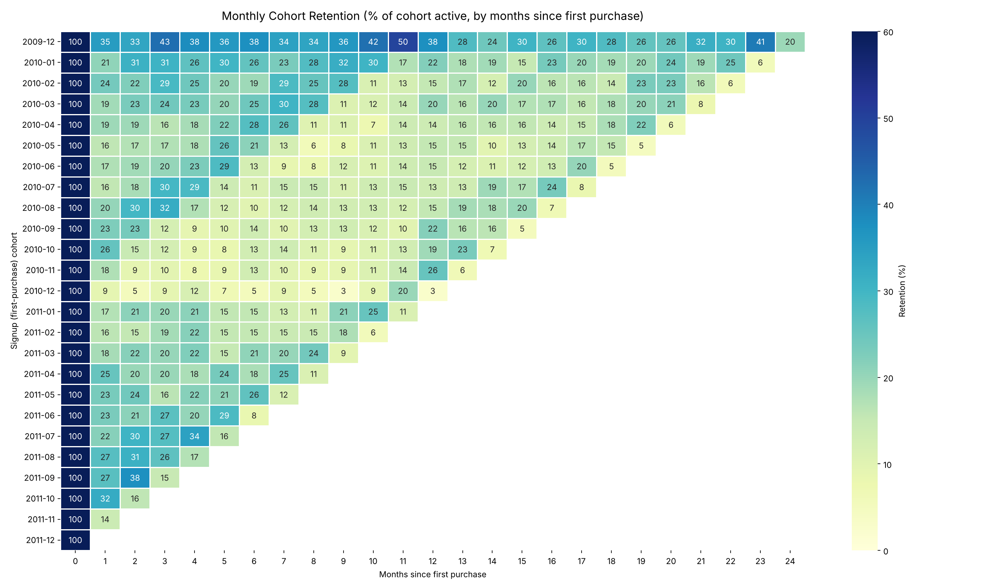

# Task 22 – Cohort Retention Basics

**Data Analytics Track** · Dataset: [Online Retail II (UCI)](https://archive.ics.uci.edu/dataset/502/online+retail+ii) · Tools: Python, SQL

## Overview

This project builds a monthly **cohort retention table** from the Online Retail II transaction data. Customers are grouped by the month of their first purchase (their signup cohort). For each cohort, we measure what percentage of customers come back to buy in each following month. The goal is to understand how customer retention behaves over time.

## Deliverables

| Deliverable | File |
|---|---|
| Cohort table (counts) | `cohort_active_customers.csv` |
| Cohort table (retention %) | `cohort_retention_pct.csv` |
| Heatmap | `cohort_retention_heatmap.png` |
| Average retention curve | `avg_retention_curve.png` |
| Insights and full write-up | `Cohort_Retention_Report.docx` |
| Python code | `cohort_analysis.py` |
| SQL code | `cohort_retention.sql` |

## Heatmap



## Dataset

- **Source:** `online_retail_II.xlsx` with two sheets (Year 2009-2010 and Year 2010-2011)
- **Raw size:** 1,067,371 rows (Dec 2009 – Dec 2011), 8 columns: `Invoice`, `StockCode`, `Description`, `Quantity`, `InvoiceDate`, `Price`, `Customer ID`, `Country`
- **After cleaning:** 779,425 line items from 5,878 unique customers

## Methodology

### Cleaning steps

1. Combine both sheets and remove 34,335 exact duplicate rows (the sheets overlap in early December 2010).
2. Drop rows with no `Customer ID`, since cohorts cannot be built for anonymous buyers.
3. Remove cancellations (invoice numbers starting with `C`) and rows with non-positive `Quantity` or `Price`.

### Definitions

- **Cohort:** the calendar month of a customer's first valid purchase.
- **Retention window:** months since first purchase (Month 0 = cohort month), applied identically to every cohort.
- **Retention rate:** customers from the cohort who purchased in Month N ÷ cohort size (Month 0).

### Python and SQL

The cohort table is built in both Python (pandas) and SQL (SQLite). The SQL output was checked against the pandas result and matches for all 25 cohorts and periods.

## How to Run

1. Install dependencies:

   ```bash
   pip install pandas numpy matplotlib seaborn openpyxl
   ```

2. Place `online_retail_II.xlsx` where the `SRC` path at the top of `cohort_analysis.py` points (edit it if needed).
3. Run the script:

   ```bash
   python cohort_analysis.py
   ```

   It writes the two CSV tables, both charts, and a cleaned transaction file used for the SQL check.
4. To run the SQL alone, load the cleaned transactions into a table named `transactions` and execute `cohort_retention.sql`.

## Key Results

- A typical new customer has about a **21%** chance of buying again in Month 1, and about **18%** are still buying at Months 6 and 12.
- The **December 2009 cohort** is the strongest (35% at Month 1, ~38% at Month 12), but it also includes existing customers because the data begins that month.
- Customers acquired in **Sep–Dec 2010** retained worst in the first months but rebound near Month 12, which points to seasonal repurchasing.
- **72.4%** of customers placed more than one order during the period.

See `Cohort_Retention_Report.docx` for the full analysis and interview answers.

## Interview Questions

**What is a cohort?**
A group of users or customers who share a common characteristic in a defined time period, such as the month they first purchased.

**Why is cohort retention useful?**
It separates customer age from calendar effects, shows when and how quickly customers drop off, allows fair comparison of different acquisition periods, and supports forecasting of repeat revenue.

## Limitations

- The data ends on 9 Dec 2011, so the last diagonal of the heatmap (and the 28-customer Dec 2011 cohort) covers a partial month.
- About 20% of rows have no `Customer ID` and are excluded, so results reflect identified customers only.
- "Signup" is approximated by first purchase, since the data has no registration date.
